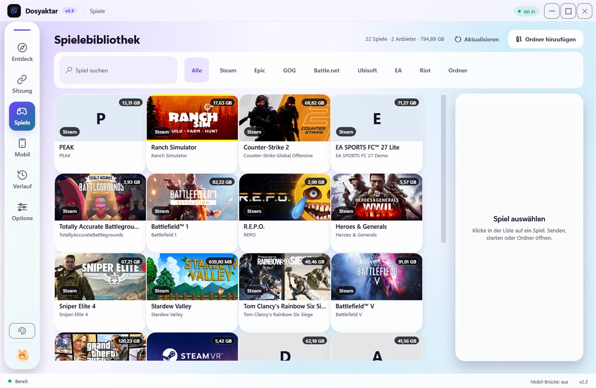
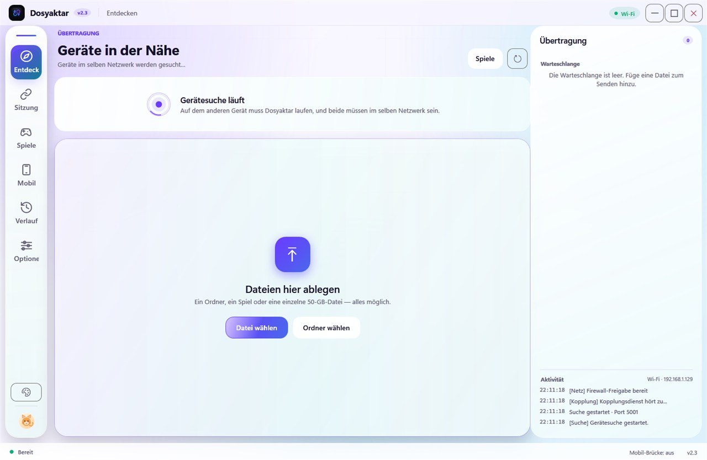
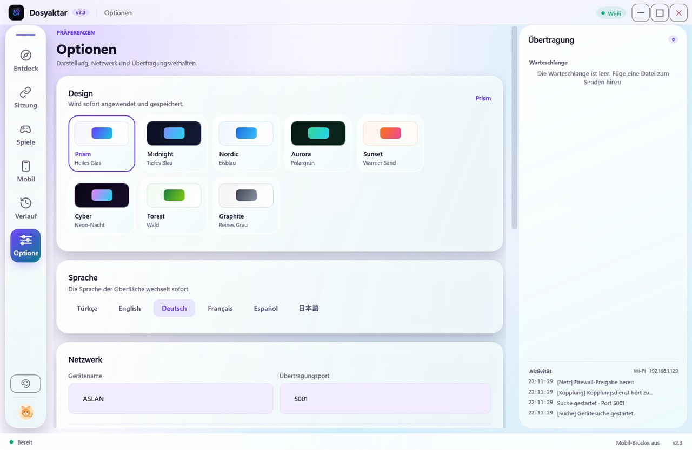

<div align="center">


# Dosyaktar

**Dateien, Ordner und installierte Spiele im lokalen Netz. Kein Internet, kein Konto, keine Werbung.**

[](https://github.com/muhammertasci11/Dosyaktar/releases/latest)
[](https://github.com/muhammertasci11/Dosyaktar/releases/download/v2.3.0/Dosyaktar.exe)


[Website](https://muhammertasci11.github.io/Dosyaktar/)

[English](README.md) &nbsp;·&nbsp; [Türkçe](README.tr.md) &nbsp;·&nbsp; **Deutsch** &nbsp;·&nbsp; [Français](README.fr.md) &nbsp;·&nbsp; [Español](README.es.md) &nbsp;·&nbsp; [日本語](README.ja.md)

</div>



## Was es ist

Dosyaktar überträgt Dateien, Ordner und **installierte Spiele** zwischen Windows-Rechnern im selben WLAN oder Ethernet. Nichts läuft über die Cloud, also gibt es kein Kontingent, kein Upload-Limit und kein Konto. Auf beiden Rechnern läuft dieselbe einzelne `.exe`; ein Installer ist nicht nötig.

Dateien werden in 8-MB-Blöcke geteilt und über **32 parallele TCP-Kanäle** übertragen, damit große Transfers die Leitung auslasten statt an einem Socket zu hängen.

## Download

- **Datei** — `Dosyaktar.exe`
- **Version** — 2.3.0
- **Größe** — 77.3 MB (77,279,571 bytes)
- **SHA-256** — `79D9FA2BEE994B7A562CE7FB986AB40DEF7A5BF9F8A1582B1F0707980272E1A9`
- **System** — Windows 10 / 11 (x64)

**[Dosyaktar v2.3.0 herunterladen](https://github.com/muhammertasci11/Dosyaktar/releases/download/v2.3.0/Dosyaktar.exe)**

> Auf beiden Rechnern muss dieselbe Version laufen. Beim ersten Start fragt die App einmalig Administratorrechte ab, um die Windows-Firewall-Regel für die LAN-Ports anzulegen.

## Schnellstart

1. **Starten** — Dosyaktar auf beiden Rechnern öffnen.
2. **Finden** — das andere Gerät erscheint nach wenigen Sekunden von selbst.
3. **Koppeln** — darauf klicken und den 6-stelligen PIN auf beiden Bildschirmen bestätigen.
4. **Übertragen** — Dateien oder Ordner ablegen oder auf der Spiele-Seite ein Spiel wählen.
5. **Telefon** — Mobil-Seite öffnen, QR-Code scannen und PIN eingeben — keine App nötig.

## Ansichten

| Spielebibliothek | Übertragung | Optionen |
|:--:|:--:|:--:|
|  |  |  |

## Funktionen

| Funktion | Wirkung |
|---|---|
| **Flash-Übertragung** — 8-MB-Blöcke über 32 parallele TCP-Kanäle | große Dateien lasten die Leitung aus, nicht einen Socket |
| **Spiele übertragen** — Steam, Epic, GOG, Battle.net, Ubisoft, EA, Riot | durchsucht installierte Bibliotheken und trägt das Spiel am Ziel-PC ein |
| **PIN-Kopplung** — 6-stelliger Code | kein Konto, keine E-Mail, kein Umweg über die Cloud |
| **Mobil-Brücke** — eingebetteter HTTP-Server | senden und empfangen im Handy-Browser, nichts zu installieren |
| **Sechs Sprachen** — TR, EN, DE, FR, ES, JA | wechselt sofort, ohne Neustart |
| **Acht Designs** — Prism, Midnight, Nordic, Aurora, Sunset, Cyber, Forest, Graphite | alle auf WCAG-AA-Kontrast geprüft |
| **Eine Datei** — eigenständige win-x64-EXE | kein Installer, keine Runtime-Installation |

## Architektur

| Komponente | Aufgabe |
|---|---|
| `Services/NetworkDiscovery.cs` | UDP 5002 Gerätesuche |
| `Services/PairingService.cs` | TCP 5003 PIN-Kopplung |
| `Services/FileTransferService.cs` | TCP 5001, 32-Kanal-Transferstrecke |
| `Services/GameLibraryService.cs` | anbieterbasierte Spielesuche |
| `Services/GameTransferService.cs` | Spielübertragung und Metadaten-Neuschreibung |
| `Services/MobileServer.cs` | eingebetteter HTTP-Server (5050) und Handy-Oberfläche |
| `Services/HistoryService.cs` | Übertragungsverlauf |
| `Services/UpdateService.cs` | Update-Prüfung über GitHub Releases |
| `Localization/Loc.cs` | Laufzeittexte für sechs Sprachen |
| `ThemeManager.cs` | acht Design-Paletten |

## Aus dem Quellcode bauen

Erfordert das .NET 8 SDK.

```bash
git clone https://github.com/muhammertasci11/Dosyaktar.git
cd Dosyaktar/Dosyaktar
dotnet build -c Debug
dotnet publish -c Release
```

Die Einzeldatei-EXE liegt danach unter `bin/Release/net8.0-windows/win-x64/publish/Dosyaktar.exe`.

## Sprachen

Oberfläche und diese Dokumentation gibt es in sechs Sprachen. Fehlende Texte fallen auf Türkisch zurück, nie auf einen Schlüssel.

[English](README.md) &nbsp;·&nbsp; [Türkçe](README.tr.md) &nbsp;·&nbsp; **Deutsch** &nbsp;·&nbsp; [Français](README.fr.md) &nbsp;·&nbsp; [Español](README.es.md) &nbsp;·&nbsp; [日本語](README.ja.md)

## Entwickler

**[Muhammer Taşçı](https://github.com/muhammertasci11)** — Student der Mechatronik, Software- und Automatisierungsentwickler.

## Lizenz

MIT — siehe [LICENSE](LICENSE).
