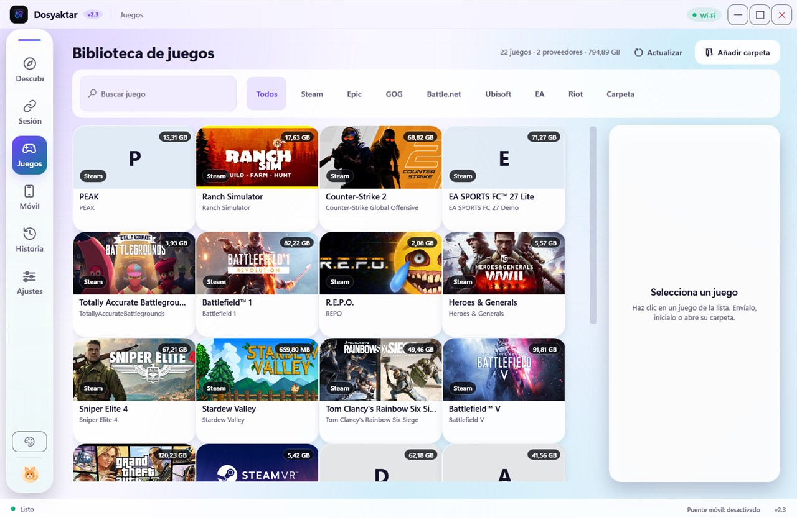
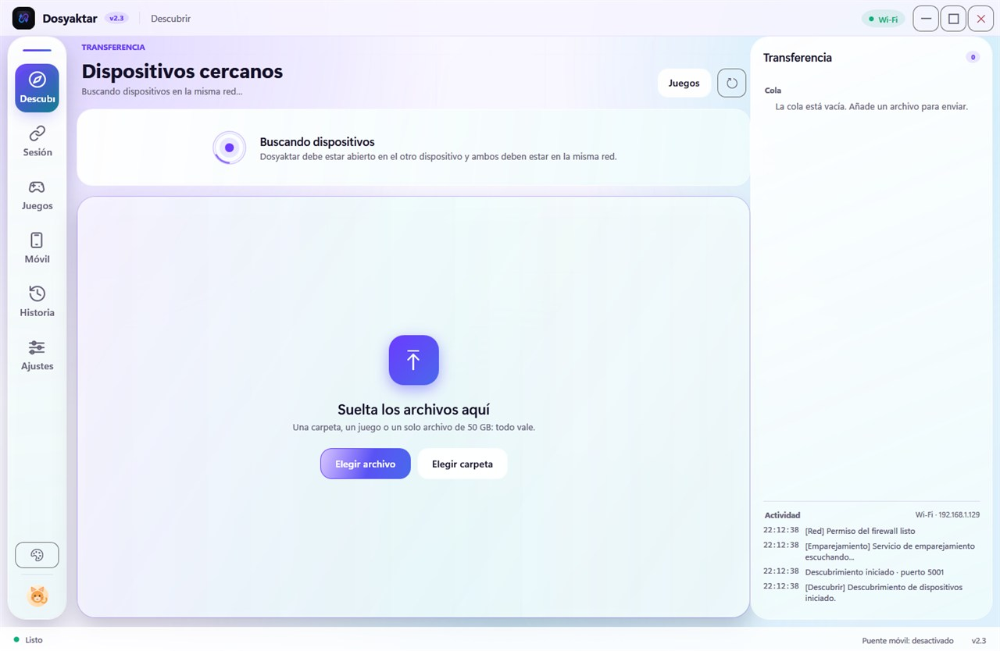
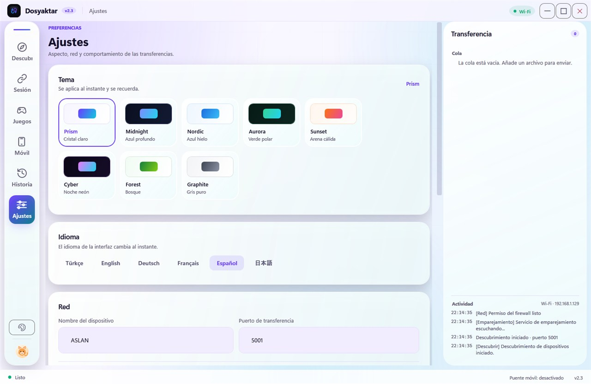

<div align="center">


# Dosyaktar

**Archivos, carpetas y juegos instalados por tu red local. Sin Internet, sin cuenta, sin anuncios.**

[](https://github.com/muhammertasci11/Dosyaktar/releases/latest)
[](https://github.com/muhammertasci11/Dosyaktar/releases/download/v2.3.0/Dosyaktar.exe)


[Sitio web](https://muhammertasci11.github.io/Dosyaktar/)

[English](README.md) &nbsp;·&nbsp; [Türkçe](README.tr.md) &nbsp;·&nbsp; [Deutsch](README.de.md) &nbsp;·&nbsp; [Français](README.fr.md) &nbsp;·&nbsp; **Español** &nbsp;·&nbsp; [日本語](README.ja.md)

</div>



## Qué es

Dosyaktar mueve archivos, carpetas y **juegos instalados** entre ordenadores Windows de la misma red Wi-Fi o Ethernet. Nada pasa por la nube: sin cuota, sin límite de subida y sin cuenta. Ambas máquinas ejecutan el mismo `.exe` único; no hay instalador.

Los archivos se dividen en bloques de 8 MB y viajan por **32 canales TCP en paralelo**, para saturar el enlace en lugar de un solo socket.

## Descarga

- **Archivo** — `Dosyaktar.exe`
- **Versión** — 2.3.0
- **Tamaño** — 77.3 MB (77,279,571 bytes)
- **SHA-256** — `79D9FA2BEE994B7A562CE7FB986AB40DEF7A5BF9F8A1582B1F0707980272E1A9`
- **Sistema** — Windows 10 / 11 (x64)

**[Descargar Dosyaktar v2.3.0](https://github.com/muhammertasci11/Dosyaktar/releases/download/v2.3.0/Dosyaktar.exe)**

> Los dos equipos deben usar la misma versión. En el primer inicio la app pide permisos de administrador una vez, para añadir la regla del firewall de Windows de los puertos LAN.

## Inicio rápido

1. **Abrir** — abre Dosyaktar en los dos ordenadores.
2. **Descubrir** — el otro equipo aparece solo en un par de segundos.
3. **Emparejar** — haz clic en él y confirma el PIN de 6 dígitos que muestran ambas pantallas.
4. **Transferir** — suelta archivos o carpetas, o elige un juego en la página Juegos.
5. **Móvil** — abre la página Móvil, escanea el código QR e introduce el PIN — no hay que instalar nada.

## Capturas

| Biblioteca de juegos | Transferencia | Ajustes |
|:--:|:--:|:--:|
|  |  |  |

## Funciones

| Función | Efecto |
|---|---|
| **Transferencia Flash** — bloques de 8 MB por 32 canales TCP en paralelo | los archivos grandes saturan el enlace, no un solo socket |
| **Transferencia de juegos** — Steam, Epic, GOG, Battle.net, Ubisoft, EA, Riot | explora las bibliotecas instaladas y registra el juego en el PC de destino |
| **Emparejamiento por PIN** — código de 6 dígitos | sin cuenta, sin correo, sin pasar por la nube |
| **Puente móvil** — servidor HTTP embebido | envía y recibe desde el navegador del móvil, nada que instalar |
| **Seis idiomas** — TR, EN, DE, FR, ES, JA | cambia al instante, sin reiniciar |
| **Ocho temas** — Prism, Midnight, Nordic, Aurora, Sunset, Cyber, Forest, Graphite | todos verificados con contraste WCAG AA |
| **Un solo archivo** — EXE win-x64 autocontenido | sin instalador y sin runtime que instalar |

## Arquitectura

| Componente | Responsabilidad |
|---|---|
| `Services/NetworkDiscovery.cs` | descubrimiento de equipos por UDP 5002 |
| `Services/PairingService.cs` | emparejamiento por PIN en TCP 5003 |
| `Services/FileTransferService.cs` | TCP 5001, canal de transferencia de 32 vías |
| `Services/GameLibraryService.cs` | exploración de juegos por proveedor |
| `Services/GameTransferService.cs` | transferencia de juegos y reescritura de metadatos |
| `Services/MobileServer.cs` | servidor HTTP embebido (5050) e interfaz móvil |
| `Services/HistoryService.cs` | historial de transferencias |
| `Services/UpdateService.cs` | comprobación de actualizaciones en GitHub Releases |
| `Localization/Loc.cs` | textos en tiempo de ejecución para seis idiomas |
| `ThemeManager.cs` | ocho paletas de tema |

## Compilar desde el código

Requiere el SDK de .NET 8.

```bash
git clone https://github.com/muhammertasci11/Dosyaktar.git
cd Dosyaktar/Dosyaktar
dotnet build -c Debug
dotnet publish -c Release
```

El EXE de archivo único queda en `bin/Release/net8.0-windows/win-x64/publish/Dosyaktar.exe`.

## Idiomas

La interfaz y esta documentación vienen en seis idiomas. Un texto que falte cae al turco, nunca a una clave.

[English](README.md) &nbsp;·&nbsp; [Türkçe](README.tr.md) &nbsp;·&nbsp; [Deutsch](README.de.md) &nbsp;·&nbsp; [Français](README.fr.md) &nbsp;·&nbsp; **Español** &nbsp;·&nbsp; [日本語](README.ja.md)

## Autor

**[Muhammer Taşçı](https://github.com/muhammertasci11)** — estudiante de Ingeniería Mecatrónica, desarrollador de software y automatización.

## Licencia

MIT — consulta [LICENSE](LICENSE).
