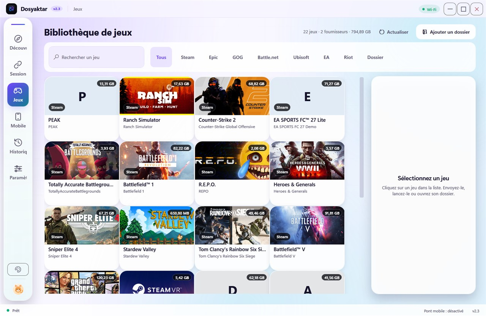
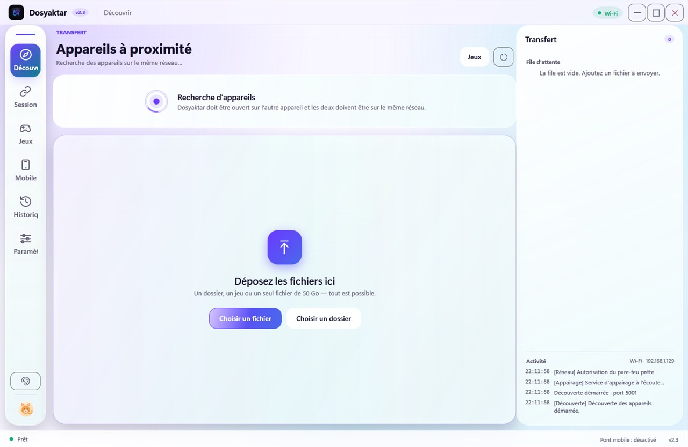
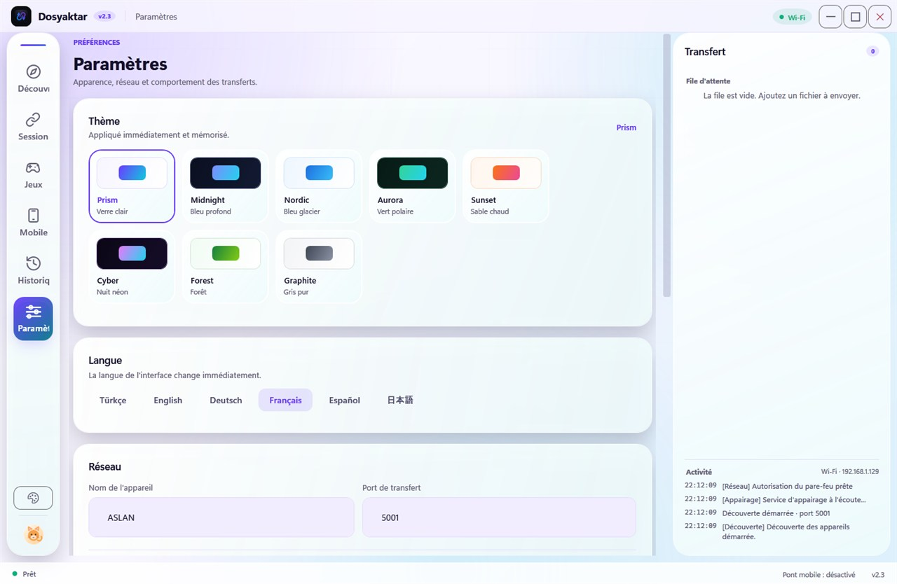

<div align="center">


# Dosyaktar

**Fichiers, dossiers et jeux installés sur votre réseau local. Sans Internet, sans compte, sans publicité.**

[](https://github.com/muhammertasci11/Dosyaktar/releases/latest)
[](https://github.com/muhammertasci11/Dosyaktar/releases/download/v2.3.0/Dosyaktar.exe)


[Site web](https://muhammertasci11.github.io/Dosyaktar/)

[English](README.md) &nbsp;·&nbsp; [Türkçe](README.tr.md) &nbsp;·&nbsp; [Deutsch](README.de.md) &nbsp;·&nbsp; **Français** &nbsp;·&nbsp; [Español](README.es.md) &nbsp;·&nbsp; [日本語](README.ja.md)

</div>



## Présentation

Dosyaktar transfère fichiers, dossiers et **jeux installés** entre ordinateurs Windows du même réseau Wi-Fi ou Ethernet. Rien ne passe par le cloud : pas de quota, pas de limite d'envoi, pas de compte. Les deux machines lancent le même `.exe` unique ; aucun installateur.

Les fichiers sont découpés en blocs de 8 Mo et transportés sur **32 canaux TCP parallèles**, pour saturer la liaison au lieu d'un seul socket.

## Téléchargement

- **Fichier** — `Dosyaktar.exe`
- **Version** — 2.3.0
- **Taille** — 77.3 MB (77,279,571 bytes)
- **SHA-256** — `79D9FA2BEE994B7A562CE7FB986AB40DEF7A5BF9F8A1582B1F0707980272E1A9`
- **Système** — Windows 10 / 11 (x64)

**[Télécharger Dosyaktar v2.3.0](https://github.com/muhammertasci11/Dosyaktar/releases/download/v2.3.0/Dosyaktar.exe)**

> Les deux ordinateurs doivent utiliser la même version. Au premier lancement, l'application demande une fois les droits administrateur pour ajouter la règle de pare-feu Windows des ports LAN.

## Démarrage rapide

1. **Lancer** — ouvrez Dosyaktar sur les deux ordinateurs.
2. **Découvrir** — l'autre appareil apparaît seul en quelques secondes.
3. **Appairer** — cliquez dessus et confirmez le PIN à 6 chiffres affiché sur les deux écrans.
4. **Transférer** — déposez fichiers ou dossiers, ou choisissez un jeu dans la page Jeux.
5. **Téléphone** — ouvrez la page Mobile, scannez le QR code et saisissez le PIN — aucune application à installer.

## Aperçus

| Bibliothèque de jeux | Transfert | Réglages |
|:--:|:--:|:--:|
|  |  |  |

## Fonctions

| Fonction | Effet |
|---|---|
| **Transfert Flash** — blocs de 8 Mo sur 32 canaux TCP parallèles | les gros fichiers saturent la liaison, pas un socket |
| **Transfert de jeux** — Steam, Epic, GOG, Battle.net, Ubisoft, EA, Riot | analyse les bibliothèques installées et enregistre le jeu sur le PC cible |
| **Appairage par PIN** — code à 6 chiffres | sans compte, sans e-mail, sans détour par le cloud |
| **Passerelle mobile** — serveur HTTP embarqué | envoyer et recevoir depuis le navigateur du téléphone, rien à installer |
| **Six langues** — TR, EN, DE, FR, ES, JA | changement immédiat, sans redémarrage |
| **Huit thèmes** — Prism, Midnight, Nordic, Aurora, Sunset, Cyber, Forest, Graphite | tous vérifiés au contraste WCAG AA |
| **Un seul fichier** — EXE win-x64 autonome | aucun installateur, aucune runtime à installer |

## Architecture

| Composant | Rôle |
|---|---|
| `Services/NetworkDiscovery.cs` | découverte des appareils en UDP 5002 |
| `Services/PairingService.cs` | appairage par PIN en TCP 5003 |
| `Services/FileTransferService.cs` | TCP 5001, chaîne de transfert à 32 canaux |
| `Services/GameLibraryService.cs` | analyse des jeux par fournisseur |
| `Services/GameTransferService.cs` | transfert de jeu et réécriture des métadonnées |
| `Services/MobileServer.cs` | serveur HTTP embarqué (5050) et interface téléphone |
| `Services/HistoryService.cs` | historique des transferts |
| `Services/UpdateService.cs` | vérification des mises à jour GitHub Releases |
| `Localization/Loc.cs` | textes d'exécution pour six langues |
| `ThemeManager.cs` | huit palettes de thème |

## Compiler depuis les sources

Nécessite le SDK .NET 8.

```bash
git clone https://github.com/muhammertasci11/Dosyaktar.git
cd Dosyaktar/Dosyaktar
dotnet build -c Debug
dotnet publish -c Release
```

L'EXE monofichier se trouve ensuite dans `bin/Release/net8.0-windows/win-x64/publish/Dosyaktar.exe`.

## Langues

L'interface et cette documentation existent en six langues. Un texte manquant retombe sur le turc, jamais sur une clé.

[English](README.md) &nbsp;·&nbsp; [Türkçe](README.tr.md) &nbsp;·&nbsp; [Deutsch](README.de.md) &nbsp;·&nbsp; **Français** &nbsp;·&nbsp; [Español](README.es.md) &nbsp;·&nbsp; [日本語](README.ja.md)

## Auteur

**[Muhammer Taşçı](https://github.com/muhammertasci11)** — étudiant en mécatronique, développeur logiciel et automatisation.
