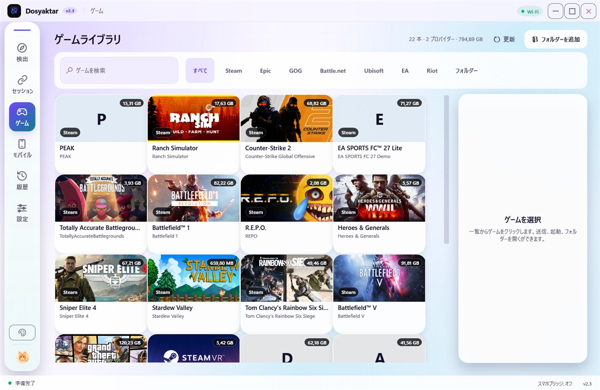
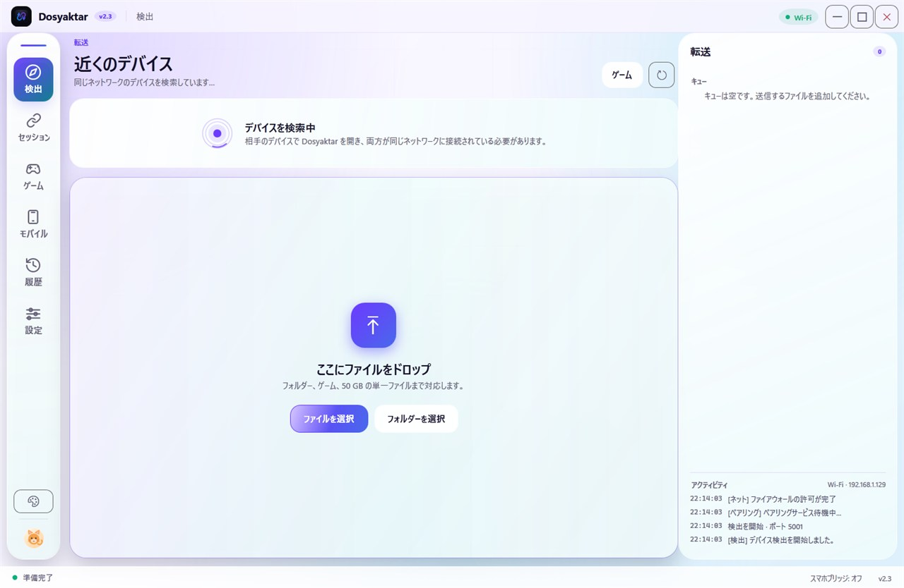
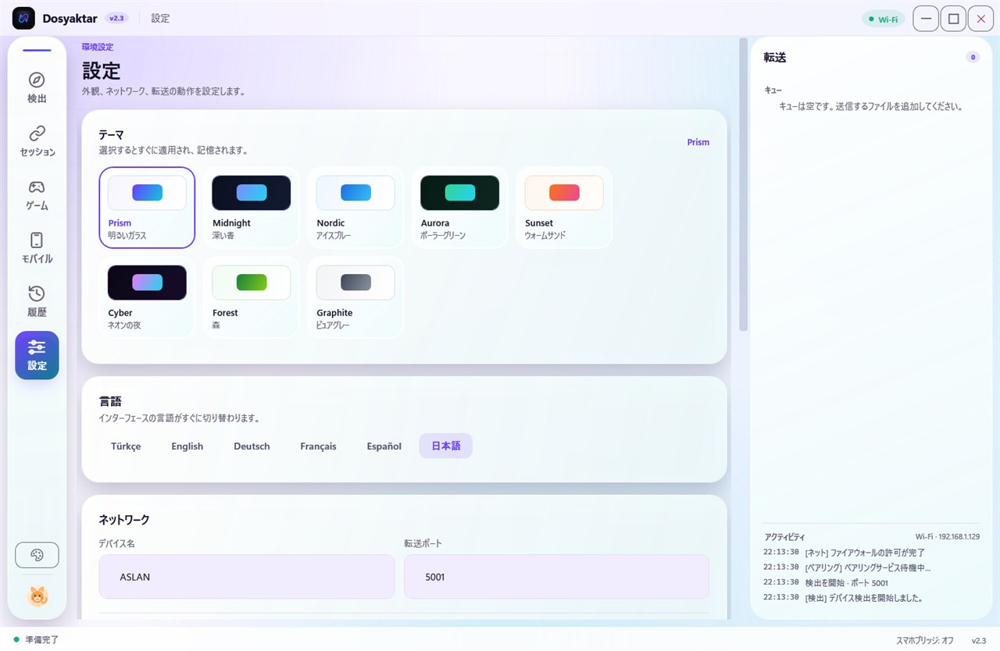

<div align="center">


# Dosyaktar

**ローカルネットワークでファイル・フォルダー・インストール済みゲームを転送。インターネット不要、アカウント不要、広告なし。**

[](https://github.com/muhammertasci11/Dosyaktar/releases/latest)
[](https://github.com/muhammertasci11/Dosyaktar/releases/download/v2.3.0/Dosyaktar.exe)


[ウェブサイト](https://muhammertasci11.github.io/Dosyaktar/)

[English](README.md) &nbsp;·&nbsp; [Türkçe](README.tr.md) &nbsp;·&nbsp; [Deutsch](README.de.md) &nbsp;·&nbsp; [Français](README.fr.md) &nbsp;·&nbsp; [Español](README.es.md) &nbsp;·&nbsp; **日本語**

</div>



## 概要

Dosyaktar は、同じ Wi-Fi または Ethernet 上の Windows PC 間でファイル・フォルダー・**インストール済みゲーム**を転送します。クラウドを経由しないため、容量制限もアップロード制限もアカウントもありません。2台とも同じ単一の `.exe` を起動するだけで、インストーラーは不要です。

ファイルは 8 MB のブロックに分割され、**32 本の TCP チャネル**で並列に転送されます。大きなファイルでも単一ソケットで止まらず、回線を使い切ります。

## ダウンロード

- **ファイル** — `Dosyaktar.exe`
- **バージョン** — 2.3.0
- **サイズ** — 77.3 MB (77,279,587 bytes)
- **SHA-256** — `30C315EF71A36E540BFF7CA3EA4AC49D77BAD648B6B82613CEA172C3DD211361`
- **対応 OS** — Windows 10 / 11 (x64)

**[Dosyaktar v2.3.0 をダウンロード](https://github.com/muhammertasci11/Dosyaktar/releases/download/v2.3.0/Dosyaktar.exe)**

> 2台とも同じバージョンで動作している必要があります。初回起動時に、LAN ポート用の Windows ファイアウォール規則を追加するため一度だけ管理者権限を求めます。

## クイックスタート

1. **起動** — 2台の PC で Dosyaktar を開きます。
2. **検出** — 相手のデバイスが数秒で自動的に表示されます。
3. **ペアリング** — クリックし、両方の画面に出る6桁の PIN を確認します。
4. **転送** — ファイルやフォルダーをドロップするか、ゲーム画面でゲームを選びます。
5. **スマホ** — モバイル画面を開き、QR コードを読み取って PIN を入力 — アプリのインストールは不要です。

## 画面

| ゲームライブラリ | 転送 | 設定 |
|:--:|:--:|:--:|
|  |  |  |

## 機能

| 機能 | 内容 |
|---|---|
| **フラッシュ転送** — 8 MB ブロックを 32 本の TCP チャネルで並列転送 | 大きなファイルでも単一ソケットではなく回線全体を使います |
| **ゲーム転送** — Steam、Epic、GOG、Battle.net、Ubisoft、EA、Riot | インストール済みライブラリを検出し、転送先 PC に登録します |
| **PIN ペアリング** — 6桁コード | アカウントもメールも不要、クラウド経由なし |
| **モバイルブリッジ** — 組み込み HTTP サーバー | スマホのブラウザから送受信、インストール不要 |
| **6言語** — TR、EN、DE、FR、ES、JA | 再起動なしで即座に切り替わります |
| **8テーマ** — Prism、Midnight、Nordic、Aurora、Sunset、Cyber、Forest、Graphite | すべて WCAG AA コントラストで確認済み |
| **単一ファイル** — 自己完結型 win-x64 EXE | インストーラー不要、ランタイムの導入も不要 |

## アーキテクチャ

| コンポーネント | 役割 |
|---|---|
| `Services/NetworkDiscovery.cs` | UDP 5002 デバイス検出 |
| `Services/PairingService.cs` | TCP 5003 PIN ペアリング |
| `Services/FileTransferService.cs` | TCP 5001、32 チャネル転送パイプライン |
| `Services/GameLibraryService.cs` | ストア別ゲーム検出 |
| `Services/GameTransferService.cs` | ゲーム転送とメタデータの書き換え |
| `Services/MobileServer.cs` | 組み込み HTTP サーバー (5050) とスマホ UI |
| `Services/HistoryService.cs` | 転送履歴 |
| `Services/UpdateService.cs` | GitHub Releases の更新確認 |
| `Localization/Loc.cs` | 6言語の実行時テキスト |
| `ThemeManager.cs` | 8つのテーマパレット |

## ソースからビルド

.NET 8 SDK が必要です。

```bash
git clone https://github.com/muhammertasci11/Dosyaktar.git
cd Dosyaktar/Dosyaktar
dotnet build -c Debug
dotnet publish -c Release
```

単一ファイル EXE は `bin/Release/net8.0-windows/win-x64/publish/Dosyaktar.exe` に出力されます。

## 言語

インターフェースとこのドキュメントは6言語で提供されます。未登録の文言はキーではなくトルコ語にフォールバックします。

[English](README.md) &nbsp;·&nbsp; [Türkçe](README.tr.md) &nbsp;·&nbsp; [Deutsch](README.de.md) &nbsp;·&nbsp; [Français](README.fr.md) &nbsp;·&nbsp; [Español](README.es.md) &nbsp;·&nbsp; **日本語**

## 作者

**[Muhammer Taşçı](https://github.com/muhammertasci11)** — メカトロニクス工学専攻、ソフトウェアおよび自動化開発者。
