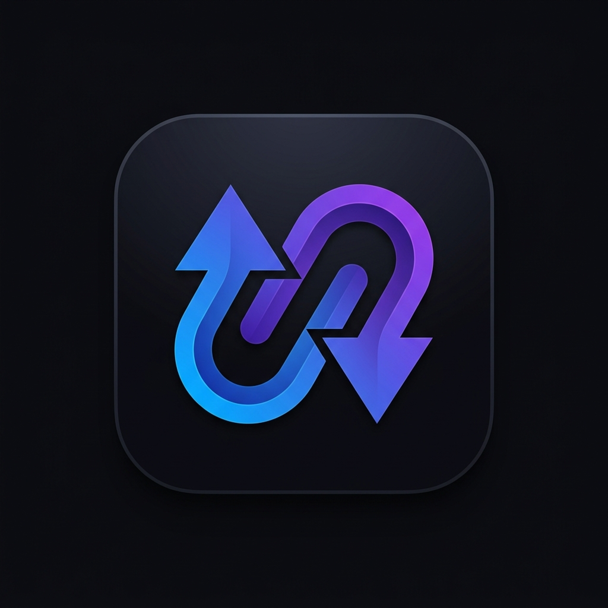
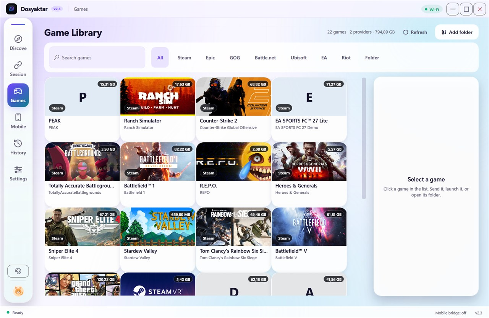
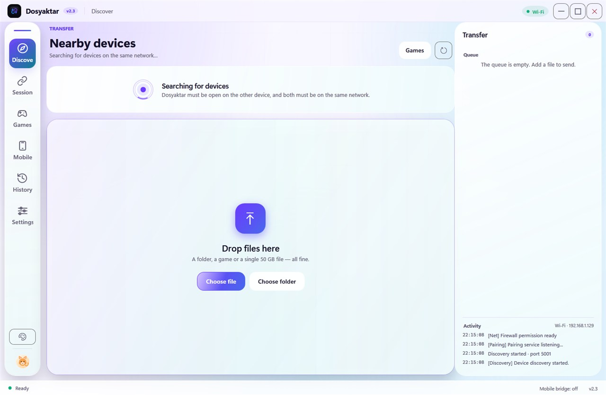
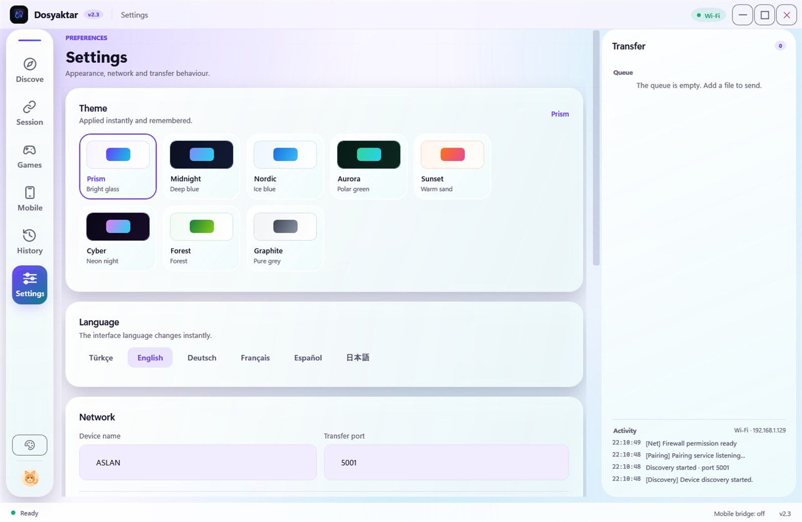

<div align="center">



# Dosyaktar

**Files, folders and installed games over your local network. No internet, no account, no ads.**

[](https://github.com/muhammertasci11/Dosyaktar/releases/latest)
[](https://github.com/muhammertasci11/Dosyaktar/releases/download/v2.3.0/Dosyaktar.exe)


[Website](https://muhammertasci11.github.io/Dosyaktar/)

**English** &nbsp;·&nbsp; [Türkçe](README.tr.md) &nbsp;·&nbsp; [Deutsch](README.de.md) &nbsp;·&nbsp; [Français](README.fr.md) &nbsp;·&nbsp; [Español](README.es.md) &nbsp;·&nbsp; [日本語](README.ja.md)

</div>



## What it is

Dosyaktar moves files, folders and **installed games** between Windows computers on the same Wi-Fi or Ethernet network. Nothing goes through the cloud, so there is no quota, no upload limit and no account. Both machines run the same single `.exe`; there is no installer.

Files are split into 8 MB chunks and carried over **32 parallel TCP channels**, so large transfers saturate the link instead of a single socket.

## Download

- **File** — `Dosyaktar.exe`
- **Version** — 2.3.0
- **Size** — 77.3 MB (77,279,571 bytes)
- **SHA-256** — `79D9FA2BEE994B7A562CE7FB986AB40DEF7A5BF9F8A1582B1F0707980272E1A9`
- **System** — Windows 10 / 11 (x64)

**[Download Dosyaktar v2.3.0](https://github.com/muhammertasci11/Dosyaktar/releases/download/v2.3.0/Dosyaktar.exe)**

> Both computers must run the same version. On first start the app asks for administrator rights once, to add the Windows Firewall rule for the LAN ports.

## Quick start

1. **Run** — open Dosyaktar on both computers.
2. **Discover** — the other device appears by itself within a couple of seconds.
3. **Pair** — click it and confirm the 6-digit PIN shown on both screens.
4. **Transfer** — drop files or folders, or pick a game on the Games page.
5. **Phone** — open the Mobile page, scan the QR code and enter the PIN — no app to install.

## Screenshots

| Game library | Transfer | Settings |
|:--:|:--:|:--:|
|  |  |  |

## Features

| Feature | What it does |
|---|---|
| **Flash transfer** — 8 MB chunks over 32 parallel TCP channels | large files saturate the link instead of one socket |
| **Game transfer** — Steam, Epic, GOG, Battle.net, Ubisoft, EA, Riot | scans installed libraries and registers the game on the target PC |
| **PIN pairing** — 6-digit code | no account, no e-mail, no cloud round trip |
| **Mobile bridge** — embedded HTTP server | send and receive from a phone browser, nothing to install |
| **Six languages** — TR, EN, DE, FR, ES, JA | switches instantly, no restart |
| **Eight themes** — Prism, Midnight, Nordic, Aurora, Sunset, Cyber, Forest, Graphite | all checked at WCAG AA contrast |
| **Single file** — self-contained win-x64 EXE | no installer, no runtime to install |

## Architecture

| Component | Responsibility |
|---|---|
| `Services/NetworkDiscovery.cs` | UDP 5002 device discovery |
| `Services/PairingService.cs` | TCP 5003 PIN pairing |
| `Services/FileTransferService.cs` | TCP 5001, 32-channel transfer pipeline |
| `Services/GameLibraryService.cs` | provider-based game scan |
| `Services/GameTransferService.cs` | game transfer and metadata rewrite |
| `Services/MobileServer.cs` | embedded HTTP server (5050) and phone UI |
| `Services/HistoryService.cs` | transfer history |
| `Services/UpdateService.cs` | GitHub Releases update check |
| `Localization/Loc.cs` | runtime strings for six languages |
| `ThemeManager.cs` | eight theme palettes |

## Build from source

Requires the .NET 8 SDK.

```bash
git clone https://github.com/muhammertasci11/Dosyaktar.git
cd Dosyaktar/Dosyaktar
dotnet build -c Debug
dotnet publish -c Release
```

The single-file EXE ends up in `bin/Release/net8.0-windows/win-x64/publish/Dosyaktar.exe`.

## Languages

The interface and these docs ship in six languages. Missing strings fall back to Turkish, never to a key.

**English** &nbsp;·&nbsp; [Türkçe](README.tr.md) &nbsp;·&nbsp; [Deutsch](README.de.md) &nbsp;·&nbsp; [Français](README.fr.md) &nbsp;·&nbsp; [Español](README.es.md) &nbsp;·&nbsp; [日本語](README.ja.md)

## Author

**[Muhammer Taşçı](https://github.com/muhammertasci11)** — Mechatronics Engineering student, software and automation developer.

## License

MIT — see [LICENSE](LICENSE).
