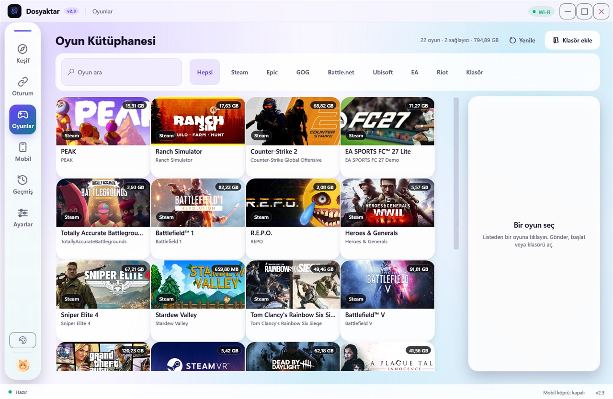
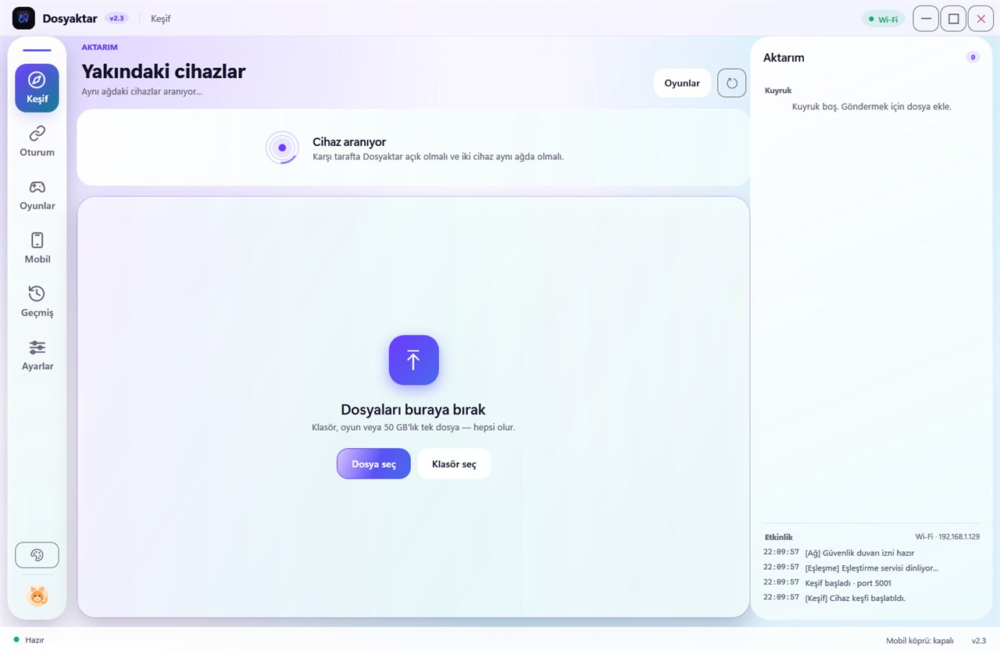
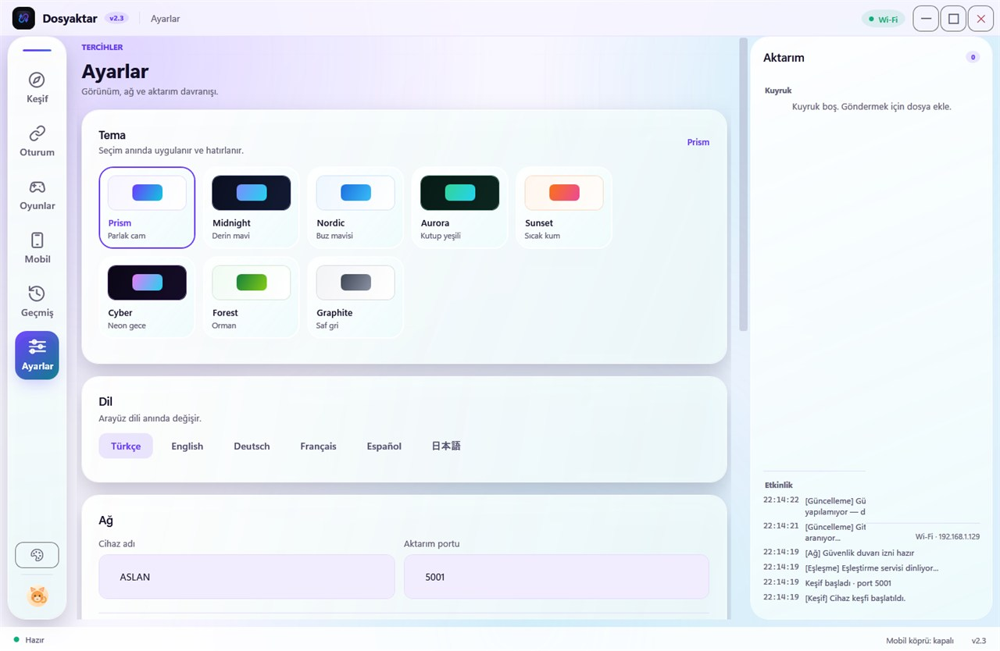

<div align="center">


# Dosyaktar

**Yerel ağda dosya, klasör ve kurulu oyun transferi. İnternet yok, hesap yok, reklam yok.**

[](https://github.com/muhammertasci11/Dosyaktar/releases/latest)
[](https://github.com/muhammertasci11/Dosyaktar/releases/download/v2.3.0/Dosyaktar.exe)


[Web sitesi](https://muhammertasci11.github.io/Dosyaktar/)

[English](README.md) &nbsp;·&nbsp; **Türkçe** &nbsp;·&nbsp; [Deutsch](README.de.md) &nbsp;·&nbsp; [Français](README.fr.md) &nbsp;·&nbsp; [Español](README.es.md) &nbsp;·&nbsp; [日本語](README.ja.md)

</div>



## Nedir

Dosyaktar, aynı Wi-Fi veya Ethernet ağındaki Windows bilgisayarlar arasında dosya, klasör ve **kurulu oyunları** taşır. Hiçbir şey buluta gitmez; kota, yükleme sınırı ve hesap yoktur. İki makinede de aynı tek `.exe` çalışır, kurulum yoktur.

Dosyalar 8 MB'lik parçalara bölünür ve **32 paralel TCP kanalı** üzerinden taşınır; büyük aktarımlar tek sokete takılmak yerine hattı doyurur.

## İndir

- **Dosya** — `Dosyaktar.exe`
- **Sürüm** — 2.3.0
- **Boyut** — 77.3 MB (77,279,571 bytes)
- **SHA-256** — `79D9FA2BEE994B7A562CE7FB986AB40DEF7A5BF9F8A1582B1F0707980272E1A9`
- **Sistem** — Windows 10 / 11 (x64)

**[Dosyaktar v2.3.0 indir](https://github.com/muhammertasci11/Dosyaktar/releases/download/v2.3.0/Dosyaktar.exe)**

> İki bilgisayarda da aynı sürüm çalışmalı. İlk açılışta uygulama, LAN portları için Windows Firewall kuralı eklemek üzere bir kez yönetici izni ister.

## Hızlı başlangıç

1. **Başlat** — Dosyaktar'ı iki bilgisayarda da açın.
2. **Keşfet** — karşı cihaz birkaç saniye içinde kendiliğinden görünür.
3. **Eşleştir** — cihaza tıklayın ve iki ekranda görünen 6 haneli PIN'i onaylayın.
4. **Aktar** — dosya veya klasör bırakın ya da Oyunlar sayfasından bir oyun seçin.
5. **Telefon** — Mobil sayfasını açın, QR kodu okutun ve PIN'i girin — uygulama kurmak gerekmez.

## Ekran görüntüleri

| Oyun kitaplığı | Aktarım | Ayarlar |
|:--:|:--:|:--:|
|  |  |  |

## Özellikler

| Özellik | Ne yapar |
|---|---|
| **Flash aktarım** — 32 paralel TCP kanalı üzerinden 8 MB'lik parçalar | büyük dosyalar tek sokete değil hattın tamamına yayılır |
| **Oyun aktarımı** — Steam, Epic, GOG, Battle.net, Ubisoft, EA, Riot | kurulu kitaplıkları tarar ve oyunu hedef bilgisayarda kaydeder |
| **PIN eşleştirme** — 6 haneli kod | hesap yok, e-posta yok, bulut turu yok |
| **Mobil köprü** — gömülü HTTP sunucusu | telefon tarayıcısından gönder ve al, kurulum yok |
| **Altı dil** — TR, EN, DE, FR, ES, JA | anında değişir, yeniden başlatma yok |
| **Sekiz tema** — Prism, Midnight, Nordic, Aurora, Sunset, Cyber, Forest, Graphite | hepsi WCAG AA kontrastında doğrulandı |
| **Tek dosya** — self-contained win-x64 EXE | kurulum yok, çalışma zamanı kurmak yok |

## Mimari

| Bileşen | Sorumluluk |
|---|---|
| `Services/NetworkDiscovery.cs` | UDP 5002 cihaz keşfi |
| `Services/PairingService.cs` | TCP 5003 PIN eşleştirme |
| `Services/FileTransferService.cs` | TCP 5001, 32 kanallı transfer hattı |
| `Services/GameLibraryService.cs` | sağlayıcı bazlı oyun taraması |
| `Services/GameTransferService.cs` | oyun aktarımı ve metadata yeniden yazma |
| `Services/MobileServer.cs` | gömülü HTTP sunucusu (5050) ve telefon arayüzü |
| `Services/HistoryService.cs` | transfer geçmişi |
| `Services/UpdateService.cs` | GitHub Releases güncelleme kontrolü |
| `Localization/Loc.cs` | altı dil için çalışma zamanı metinleri |
| `ThemeManager.cs` | sekiz tema paleti |

## Kaynaktan derleme

.NET 8 SDK gerekir.

```bash
git clone https://github.com/muhammertasci11/Dosyaktar.git
cd Dosyaktar/Dosyaktar
dotnet build -c Debug
dotnet publish -c Release
```

Tek dosya EXE çıktısı `bin/Release/net8.0-windows/win-x64/publish/Dosyaktar.exe` altında oluşur.

## Diller

Arayüz ve bu dokümanlar altı dilde gelir. Eksik metin anahtar değil, Türkçe kaynağa düşer.

[English](README.md) &nbsp;·&nbsp; **Türkçe** &nbsp;·&nbsp; [Deutsch](README.de.md) &nbsp;·&nbsp; [Français](README.fr.md) &nbsp;·&nbsp; [Español](README.es.md) &nbsp;·&nbsp; [日本語](README.ja.md)

## Geliştirici

**[Muhammer Taşçı](https://github.com/muhammertasci11)** — Mekatronik Mühendisliği öğrencisi, yazılım ve otomasyon geliştirici.

## Lisans

MIT — [LICENSE](LICENSE) dosyasına bakın.
